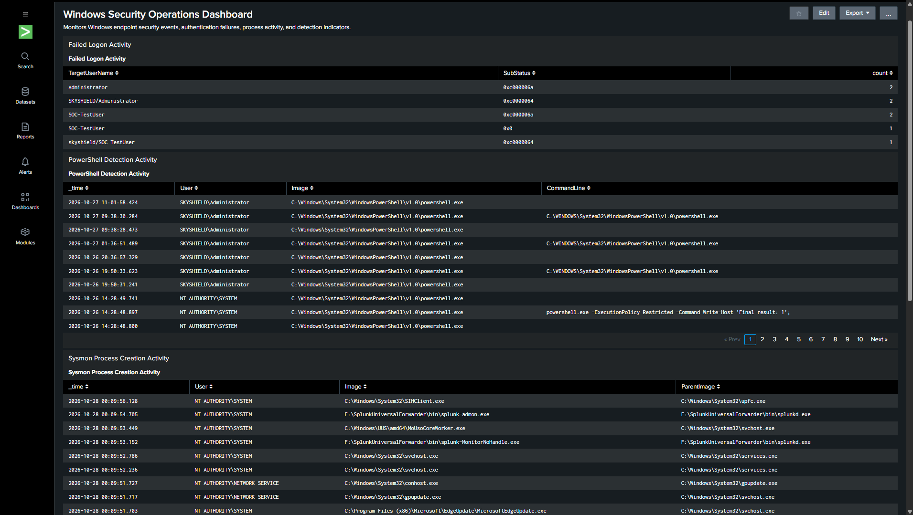
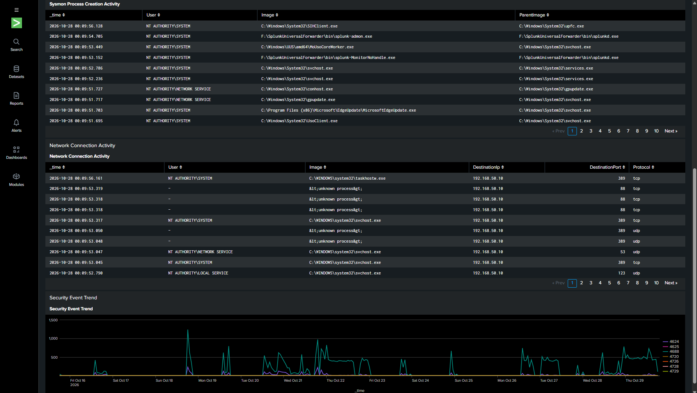

# Windows Endpoint Security Monitoring & Investigation Lab

## Overview
This project demonstrates hands-on Windows security monitoring and event investigation using Windows Security auditing, Event Viewer, and an Active Directory lab environment.

The goal is to understand how Windows records authentication activity, process creation, account changes, and security-group membership changes, and how an analyst can use those events to investigate activity.

## Featured SOC Investigations

The following investigations demonstrate hands-on security monitoring, threat detection, incident analysis, and response within an isolated Windows Active Directory lab.

### 1. Active Directory Privilege Escalation Investigation
- Investigated Windows Security Event IDs 4720, 4728, and 4729.
- Developed SPL detection logic to monitor Domain Admins membership changes.
- Configured and tuned a scheduled high-severity Splunk alert.
- Validated automated detection through a controlled privilege escalation simulation.
- Documented investigation findings and remediation.

**[View Privilege Escalation Investigation](documentation/privilege-escalation-investigation.md)**

### 2. Account Compromise Investigation
- Analyzed Windows authentication and security events.
- Correlated security telemetry to investigate suspicious account activity.
- Documented investigation findings and response procedures.

**[View Account Compromise Investigation](documentation/account-compromise-investigation.md)**

### 3. Windows Endpoint Threat Detection
- Used Windows Security auditing, Sysmon, and Splunk Enterprise to investigate endpoint activity.
- Developed detection logic for suspicious PowerShell execution and process activity.
- Practiced security event triage and analysis.

## Lab Environment
- **Domain:** `skyshield.local`
- **Domain Controller:** `SKY-SRV-01` (Windows Server)
- **Workstation:** `WS01` (Windows 11)
- **Virtualization:** Oracle VirtualBox
- **Tools:** Windows Event Viewer, Windows Advanced Audit Policy, `auditpol`, Active Directory Users and Computers

### Endpoint Naming Convention

Within this project, **WS01** refers to the Windows 11 lab workstation by its designated lab identifier. Its actual Windows hostname is **DESKTOP-RRPR83H**.

- **Lab Identifier:** WS01
- **Windows Hostname:** `DESKTOP-RRPR83H`
- **Operating System:** Windows 11
- **Telemetry Host Field:** `DESKTOP-RRPR83H`

References to WS01 throughout this documentation identify the same endpoint as `DESKTOP-RRPR83H` in Windows Event Viewer, Sysmon, and Splunk search results.

## Skills Demonstrated

### SIEM & Security Monitoring
- Splunk Enterprise deployment, configuration, and log analysis
- Search Processing Language (SPL) for security event investigation
- Windows Security Event Logs and Sysmon telemetry analysis
- Security dashboard creation and monitoring

### Threat Detection & Detection Engineering
- Developing and validating custom SPL detection searches
- Configuring, testing, and tuning scheduled Splunk security alerts
- Detecting suspicious PowerShell execution and process creation
- Monitoring authentication failures and privileged group membership changes
- Investigating Windows Security Event IDs 4624, 4625, 4688, 4720, 4728, and 4729

### Active Directory & Windows Security
- Active Directory user and security-group administration
- Privileged account monitoring and access control analysis
- Windows Advanced Audit Policy configuration and verification
- Windows endpoint security monitoring and event correlation

### SOC Investigation & Incident Response
- Investigating suspicious authentication and endpoint activity
- Correlating security events using timestamps, user identities, and process information
- Validating security alerts through controlled lab simulations
- Documenting investigation findings, supporting evidence, and remediation
- Distinguishing confirmed security events from potential incidents and false positives

## Event IDs Investigated

| Event ID | Activity | Lab Finding |
|---|---|---|
| 4624 | Successful logon | Inspected successful authentication events and logon types |
| 4625 | Failed logon | Investigated failed authentication events and available source information |
| 4688 | Process creation | Confirmed process-creation auditing by launching and inspecting Notepad |
| 4720 | User account created | Reviewed account-management events |
| 4726 | User account deleted | Reviewed account-management events |
| 4728 | Member added to a global security group | Correlated the event with adding `jlee` to `IT-Support` |
| 4729 | Member removed from a global security group | Verified the event generated by a controlled removal of `jlee` from `IT-Support` |

**Note:** Event IDs 4720 and 4726 were reviewed in the Security log; findings should be interpreted according to the specific event details and available evidence.

## Investigation Approach
For each investigation, I reviewed relevant event details, including the event ID, timestamp, account identities, logon type, group name, and available process or source information.

I compared event details against known lab activity where possible. When the evidence did not conclusively identify an action or affected account, I documented that limitation rather than assuming malicious activity.

## Security Relevance
Windows Security events can help administrators and security analysts investigate authentication failures, review program execution, validate account-management activity, and identify unexpected changes to access permissions.

Reliable investigations require correlating timestamps, identities, event details, and authorized administrative actions before reaching conclusions.

## Project Status
This is an ongoing, isolated hands-on lab. Additional investigations, screenshots, and audit-policy documentation will be added as the project develops.

## Disclaimer
All testing was performed in a controlled virtual lab for educational and professional development purposes. This project demonstrates foundational Windows security monitoring and event investigation; it is not a production SOC or SIEM deployment.

## Live SIEM Monitoring & Detection

- [Live Sysmon Telemetry & Splunk Detection](documentation/splunk-live-sysmon-detection.md) — Documents live Sysmon event forwarding to Splunk Enterprise, XML field extraction, and validation of a process-creation detection search.
- [Live Splunk Detection Evidence](screenshots/splunk-live-sysmon-detection.png) — Screenshot showing the detection search matching live Sysmon telemetry.

### PowerShell Execution Policy Bypass Detection

- Developed a Splunk SPL search to identify PowerShell process-creation events containing execution-policy bypass and encoded-command arguments.
- Validated the detection using a controlled PowerShell test command and live Sysmon telemetry.
- [Detection Documentation](documentation/powershell-executionpolicy-detection.md)
- [Detection Evidence](screenshots/splunk-powershell-executionpolicy-detection.png)

### PowerShell Process Investigation

- Investigated Sysmon process-creation events using Splunk SPL.
- Extracted user, executable, command-line, and parent-process context to examine a PowerShell process relationship.
- Assessed the observed activity against the controlled lab test and documented investigation limitations.
- [Investigation Documentation](documentation/powershell-process-investigation.md)
- [Investigation Evidence](screenshots/splunk-powershell-process-investigation.png)

### PowerShell Multi-Indicator Detection

- Developed a Splunk SPL search to identify encoded-command, execution-policy bypass, and hidden-window arguments in Sysmon process-creation events.
- Classified matching events by indicator and included user, executable, command-line, and parent-process context.
- Validated the search against controlled PowerShell test activity and saved it as a reusable Splunk report.
- [Detection Documentation](documentation/powershell-multi-indicator-detection.md)
- [Detection Evidence](screenshots/splunk-powershell-multi-indicator-detection.png)

### PowerShell Multi-Indicator Detection Alert

- Configured a scheduled Splunk Enterprise alert to evaluate Sysmon process-creation events every five minutes.
- Set a 10-minute search window and a trigger condition of more than zero matching results.
- Validated the alert using controlled PowerShell test activity and reviewed the matching event through the alert's View Results link.
- [Alert Configuration Documentation](documentation/powershell-multi-indicator-alert.md)
- [Alert Evidence Screenshot](screenshots/splunk-powershell-multi-indicator-alert.png)
- [Scheduled Alert Validation Evidence](screenshots/splunk-scheduled-alert-validation.png)
- **Alert Triage Investigation:** [PowerShell Alert Triage Investigation](documentation/powershell-alert-triage.md)
- [SOC Process Investigation and Escalation Analysis](documentation/soc-process-investigation-and-escalation.md)

### Incident Correlation and Severity Assessment

- Correlated Sysmon process-creation (Event ID 1) and network-connection (Event ID 3) events in Splunk Enterprise.
- Investigated outbound connections to `150.171.22.17:443` and correlated them with Microsoft Edge Update process activity.
- Validated the executable's Authenticode signature using PowerShell and calculated elapsed time between process creation and network connections.
- Assessed the activity as likely benign, with a provisional Informational / Low severity, based on the available evidence and documented investigation limitations.
- [Investigation Documentation](documentation/incident-correlation-and-severity-assessment.md)
- [Network Connection Evidence](screenshots/splunk-incident-network-connections.png)
- [Process Correlation Evidence](screenshots/splunk-edge-update-process-correlation.png)
- [Digital Signature Validation Evidence](screenshots/edge-update-digital-signature-validation.png)
- [Correlation Timing Evidence](screenshots/splunk-incident-correlation-timing.png)

### Account Compromise Investigation — End-to-End SOC Case Study

- Conducted an end-to-end investigation of Windows authentication and endpoint activity associated with `SKYSHIELD\SOC-TestUser`.
- Analyzed successful and failed authentication events using Windows Security Event IDs 4624 and 4625.
- Investigated process execution and outbound network connections using Sysmon Event IDs 1 and 3.
- Correlated process creation and network activity using the Sysmon Process GUID.
- Validated the Microsoft digital signature of `backgroundTaskHost.exe` using PowerShell.
- Examined destination hostname information and assessed the observed network activity.
- Documented the investigation timeline, supporting evidence, analyst assessment, and recommended follow-up actions.
- **[Account Compromise Investigation Report](documentation/account-compromise-investigation.md)**

### Windows Failed Logon Detection — Event ID 4625

- Configured Windows Security event collection through Splunk Universal Forwarder and Splunk Enterprise.
- Developed and saved a Splunk SPL search to identify failed logon events (Event ID 4625).
- Extracted target usernames and substatus values from Windows event XML to investigate authentication failures.
- Aggregated failed logons by account and substatus, including the most recent event timestamp.
- Validated the detection using a controlled `runas` authentication attempt with an incorrect password.
- Confirmed that the resulting Windows Security event was searchable in Splunk.
- [Detection Evidence](screenshots/windows-failed-logon-detection.png)

## Windows Security Operations Dashboard

Developed a five-panel dashboard in Splunk Enterprise to provide centralized visibility into Windows endpoint security telemetry collected from WS01.

### Dashboard Panels

| Panel | Purpose | Data Source |
|---|---|---|
| Failed Logon Activity | Monitors unsuccessful authentication attempts | Windows Security Event ID 4625 |
| PowerShell Detection Activity | Displays PowerShell execution activity and command-line details | Sysmon process telemetry |
| Sysmon Process Creation Activity | Monitors process execution and parent-child relationships | Sysmon Event ID 1 |
| Network Connection Activity | Displays endpoint network connections, destination IPs, and ports | Sysmon Event ID 3 |
| Security Event Trend | Visualizes hourly Windows Security event volume | Windows Security Logs |

### Dashboard Evidence

**Dashboard Overview**

**Dashboard Lower Panels**

### Monitoring Capabilities

- Authentication failure monitoring
- PowerShell execution visibility
- Process creation and parent-process analysis
- Network connection monitoring
- Time-based Windows Security event analysis

**Platform:** Splunk Enterprise 10.6.1.1  
**Endpoint:** Windows 11 (WS01)  
**Telemetry:** Windows Security Logs and Sysmon

## Evidence Screenshots

The following screenshots document selected investigations performed in the lab.

| Event ID | Investigation | Evidence |
|---|---|---|
| 4625 | Failed logon investigation | [View screenshot](screenshots/event-4625-failed-logon.png) |
| 4688 | Process creation monitoring | [View screenshot](screenshots/event-4688-process-creation.png) |
| 4728 | Active Directory group addition | [View screenshot](screenshots/event-4728-ad-group-addition.png) |
| 4729 | Active Directory group removal | [View screenshot](screenshots/event-4729-ad-group-removal.png) |

### Sysmon Evidence

- [Sysmon Event ID 1 — Process Creation](screenshots/sysmon-event-1-process-creation.png)
- [Sysmon Event ID 3 — Network Connection](screenshots/sysmon-event-3-network-connection.png)
- [Windows Security Event ID 4688 — Notepad Process Creation](screenshots/windows-security-event-4688-notepad.png)

## Documentation

- [Incident Response Runbook](documentation/incident-response-runbook.md) — Documents the investigation workflow for failed logons, Sysmon process creation, PowerShell activity, event correlation, severity assessment, and escalation.
- [Event Investigations](documentation/event-investigations.md)
- [Audit Policy Configuration](documentation/audit-policy.md)
- [Sysmon Process and Network Monitoring Investigation](documentation/sysmon-investigation.md)
- [Active Directory Privilege Escalation Investigation](documentation/privilege-escalation-investigation.md) — Investigated privileged group membership changes, developed and tuned a scheduled Splunk alert using Event ID 4728, validated automated detection, and documented remediation.

## Key Takeaways

Through this lab, I practiced:

- Configuring and verifying Windows Advanced Audit Policy settings.
- Using Event Viewer to filter and inspect Windows Security events.
- Investigating failed authentication attempts and interpreting logon types.
- Enabling process-creation auditing and validating it with Event ID 4688.
- Correlating Active Directory group-membership events with controlled administrative changes.
- Distinguishing confirmed evidence from assumptions when investigating security events.
- Documenting investigation steps, findings, and limitations for technical review.

## Next Steps

Potential future enhancements include:

- Expanding detection coverage for additional Windows Security and Sysmon event types.
- Developing additional alerting scenarios for suspicious authentication and account-management activity.
- Improving dashboard filtering, visualization, and time-range controls.
- Conducting additional controlled security investigations to validate detection accuracy.
- Expanding incident response documentation with additional investigation scenarios.
- Exploring Microsoft Defender security investigation workflows.
