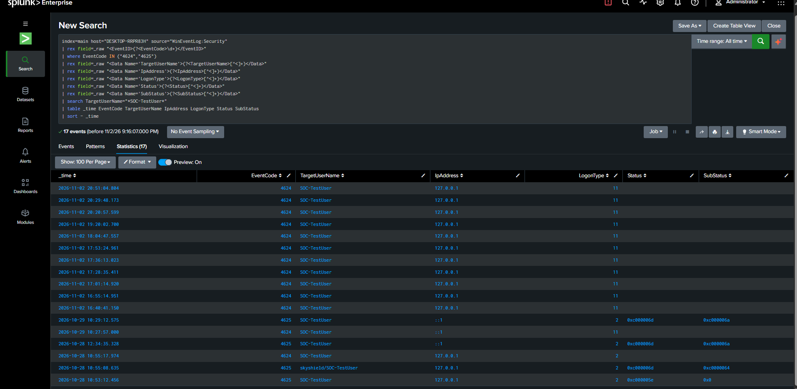
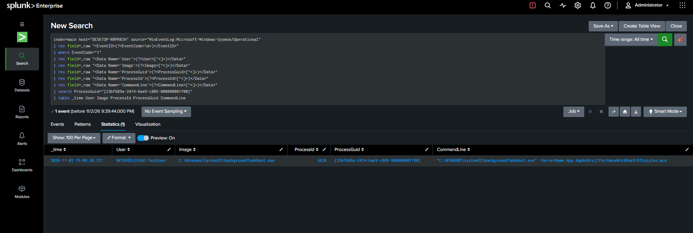
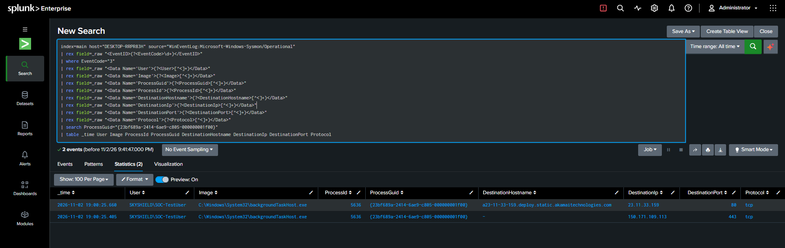

# Account Compromise Investigation — End-to-End SOC Case Study

## 1. Investigation Overview

**Investigation Type:** Windows Account Activity and Endpoint Investigation  
**Environment:** Windows 11 / Active Directory Lab  
**SIEM:** Splunk Enterprise 10.6.1.1  
**Endpoint:** WS01 (`DESKTOP-RRPR83H`)  
**Domain:** `skyshield.local`  
**Account Investigated:** `SKYSHIELD\SOC-TestUser`  
**Telemetry Sources:** Windows Security Event Logs and Sysmon Operational Logs

### Objective

Investigate authentication activity associated with a test domain account, examine subsequent process execution, correlate network connections with process activity, and document an evidence-based analyst assessment.

This was a controlled lab investigation. The activity was not a confirmed account compromise.

## 2. Investigation Scope

The investigation examined:

- Successful authentication events (Event ID 4624).
- Failed authentication events (Event ID 4625).
- Process creation events (Sysmon Event ID 1).
- Network connection events (Sysmon Event ID 3).
- Executable digital signature validity.
- Network destination hostname information.
- Correlation of process and network events using Process GUID.

## 3. Authentication Investigation

The initial review identified:

- 4,301 successful logon events (Event ID 4624).
- 13 failed logon events (Event ID 4625).

The failed logon records included activity involving `SOC-TestUser` and other accounts.

Examples included:
- `0xc000006a`: Incorrect password.
- `0xc0000064`: Account does not exist or could not be recognized.
- `0xc000005e`: No logon servers available.

Successful authentication records for `SOC-TestUser` included:
- October 28, 2026 — Interactive logon (Logon Type 2).
- October 29, 2026 — Cached interactive logon (Logon Type 11).

The observed authentication records included loopback addresses (`127.0.0.1` and `::1`).

**Assessment:** The authentication records provided context for account activity but did not independently establish unauthorized access.

## 4. Process Execution Investigation

Sysmon Event ID 1 was used to examine process execution under `SKYSHIELD\SOC-TestUser`.

Observed processes included Windows components such as:

- `explorer.exe`
- `RuntimeBroker.exe`
- `taskhostw.exe`
- `backgroundTaskHost.exe`
- `msedgewebview2.exe`
- `smartscreen.exe`
- `WindowsTerminal.exe`

Controlled command execution tests also produced process records for `whoami.exe` and `hostname.exe`.

The investigation then focused on a network connection initiated by `backgroundTaskHost.exe`.

### Process Creation Evidence

| Field | Value |
|---|---|
| Timestamp | November 2, 2026, 19:00:20.221 |
| User | `SKYSHIELD\SOC-TestUser` |
| Image | `C:\Windows\System32\backgroundTaskHost.exe` |
| Process ID | 5636 |
| Command Line | `backgroundTaskHost.exe -ServerName:App.AppXe9cvj1thv1hmcw0cs98xm3r97tyzy2xs.mca` |
| Parent Image | Not populated |
| Process GUID | `{23bf689a-2414-6ae9-c805-000000001f00}` |

## 5. Network Activity Investigation

Sysmon Event ID 3 identified an outbound connection initiated by the same process instance.

### Network Connection Evidence

| Field | Value |
|---|---|
| Timestamp | November 2, 2026, 19:00:25.660 |
| User | `SKYSHIELD\SOC-TestUser` |
| Process | `backgroundTaskHost.exe` |
| Destination IP | `23.11.33.159` |
| Destination Port | 80 |
| Protocol | TCP |
| Destination Hostname | `a23-11-33-159.deploy.static.akamaitechnologies.com` |
| Initiated | True |
| Process GUID | `{23bf689a-2414-6ae9-c805-000000001f00}` |

The destination hostname was associated with Akamai infrastructure.

Similar connections to the same IP were observed across multiple dates and from several Windows processes, including `BackgroundTransferHost.exe`, `Widgets.exe`, `SearchHost.exe`, `svchost.exe`, and Microsoft Defender components.

This pattern was consistent with recurring Windows application and content-delivery activity, although destination ownership and application attribution were not independently established.

## 6. Process and Network Correlation

The process creation and network connection records shared the same Process GUID:

`{23bf689a-2414-6ae9-c805-000000001f00}`

The process was created at 19:00:20.221 and initiated the network connection at 19:00:25.660.

This established a correlation between the specific process instance and the observed outbound connection.

The investigation used Process GUID rather than relying solely on executable names or process IDs.

## 7. Executable Validation

PowerShell's `Get-AuthenticodeSignature` cmdlet was used to validate the executable:

`C:\Windows\System32\backgroundTaskHost.exe`

Results:

| Property | Result |
|---|---|
| Signature Status | Valid |
| Verification Message | Signature verified |
| Publisher | Microsoft Corporation |
| Certificate Subject | Microsoft Windows |
| Certificate Issuer | Microsoft Windows Production PCA 2026 RSA2048-SHA256 |
| Certificate Expiration | August 5, 2027 |

The executable had a valid Microsoft digital signature.

A valid signature supports executable authenticity but does not independently establish that all process behavior is benign.

## 8. Investigation Timeline

| Date and Time | Event | Finding |
|---|---|---|
| Oct. 28–29, 2026 | Authentication review | Successful and failed logon activity identified |
| Nov. 2, 19:00:20.221 | Sysmon Event ID 1 | `backgroundTaskHost.exe` created |
| Nov. 2, 19:00:25.660 | Sysmon Event ID 3 | Same process initiated TCP connection to `23.11.33.159:80` |
| Nov. 2, 2026 | Signature validation | Microsoft digital signature verified |
| Nov. 2, 2026 | Destination investigation | Akamai-associated hostname identified |

## 9. Analyst Assessment

**Preliminary Classification:** Likely Benign  
**Confirmed Account Compromise:** No  
**Application Attribution:** Unresolved

The observed process was located in the Windows System32 directory and had a valid Microsoft digital signature. Its network connection was correlated to the exact process instance through its Process GUID.

The destination hostname was associated with Akamai infrastructure, and similar connections were observed from multiple Windows components over time.

The available evidence did not establish malicious execution, unauthorized access, or account compromise.

The application responsible for the background task was not conclusively identified. Further validation would be appropriate before treating the activity as definitively benign.

## 10. Recommended Follow-Up Actions

1. Continue monitoring authentication failures and unusual successful logons.
2. Investigate unexpected process execution under domain accounts.
3. Correlate Sysmon process and network events using Process GUID.
4. Validate executable signatures and investigate unexpected executable paths.
5. Review unfamiliar network destinations and their associated processes.
6. Investigate account activity if future evidence indicates unauthorized access.
7. Preserve relevant event records and screenshots for investigation documentation.

## 11. Skills Demonstrated

- Splunk Enterprise search and event analysis
- Windows Security Event Log investigation
- Sysmon process and network telemetry analysis
- Authentication investigation
- Process GUID correlation
- PowerShell executable signature validation
- Network destination investigation
- Evidence documentation and incident assessment
- SOC investigation workflow and reporting

## Evidence Screenshots

### Authentication Activity

### Process Creation

### Network Connection

## 12. Conclusion

This case study demonstrates an end-to-end Windows endpoint investigation using Splunk, Windows Security logs, Sysmon, and PowerShell.

The investigation connected authentication context, process execution, network activity, and executable validation into a documented analyst assessment.

The findings supported a preliminary likely-benign classification for the examined process activity. No confirmed account compromise was established.