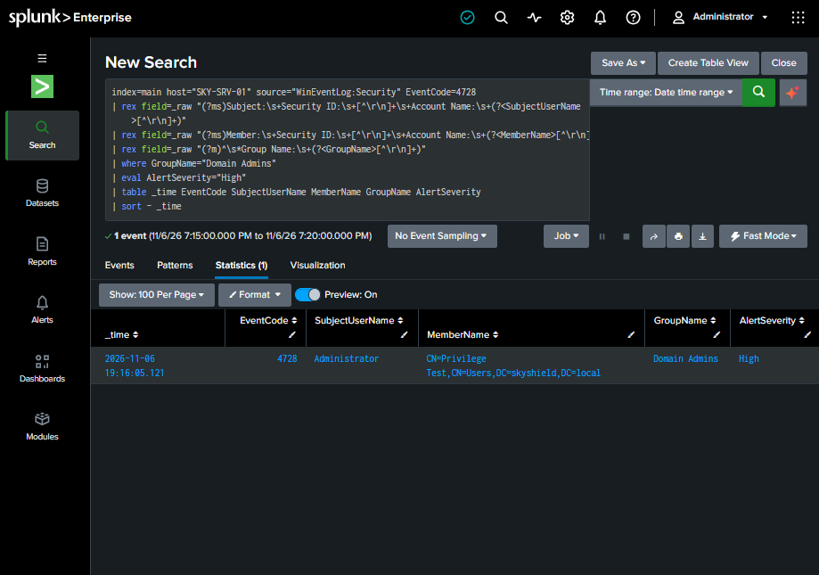

# Active Directory Privileged Group Membership Investigation

## 1. Investigation Overview

This investigation documents a controlled privilege escalation simulation conducted within an isolated Active Directory lab environment.

The objective was to identify, investigate, and alert on changes to privileged Active Directory group membership using Windows Security Event Logs and Splunk Enterprise.

**Environment:**
- Domain: `skyshield.local`
- Domain Controller: `SKY-SRV-01`
- SIEM: Splunk Enterprise
- Log Source: Windows Security Event Logs
- Test Account: `Privilege.Test`
- Target Group: `Domain Admins`
- Alert Severity: High

## 2. Security Scenario

A test account was created and added to an Active Directory security group before being temporarily added to the Domain Admins group.

Membership in Domain Admins grants highly privileged access within the domain. Unauthorized additions may indicate account compromise, privilege escalation, or malicious administrative activity.

All changes were performed intentionally in an authorized lab environment.

## 3. Windows Security Events

The following Windows Security Event IDs were used to reconstruct the activity:

| Event ID | Description |
|----------|-------------|
| 4720 | A user account was created |
| 4728 | A member was added to a security-enabled global group |
| 4729 | A member was removed from a security-enabled global group |

### Investigation Timeline

| Date / Time (EST) | Event ID | Activity |
|-------------------|----------|----------|
| Nov 6, 2026, 14:30:44 | 4720 | Administrator created Privilege.Test |
| Nov 6, 2026, 14:52:57 | 4728 | Privilege.Test added to IT-Support |
| Nov 6, 2026, 15:45:47 | 4728 | Privilege.Test added to Domain Admins |
| Nov 6, 2026, 16:11:39 | 4729 | Privilege.Test removed from Domain Admins |
| Nov 6, 2026, 19:16:05 | 4728 | Privilege.Test added to Domain Admins during alert validation |
| Nov 6, 2026, 19:20:01 | Alert | Scheduled Splunk detection triggered |

The test account was also removed from Domain Admins following the final validation test.

## 4. Splunk Detection Logic

The following SPL search identifies additions to the Domain Admins group.

```spl
index=main host="SKY-SRV-01" source="WinEventLog:Security" EventCode=4728
| rex field=_raw "(?ms)Subject:\s+Security ID:\s+[^\r\n]+\s+Account Name:\s+(?<SubjectUserName>[^\r\n]+)"
| rex field=_raw "(?ms)Member:\s+Security ID:\s+[^\r\n]+\s+Account Name:\s+(?<MemberName>[^\r\n]+)"
| rex field=_raw "(?m)^\s*Group Name:\s+(?<GroupName>[^\r\n]+)"
| where GroupName="Domain Admins"
| eval AlertSeverity="High"
| table _time EventCode SubjectUserName MemberName GroupName AlertSeverity
| sort - _time
```

The search extracts the initiating account, affected account, and target security group from Windows Security event data.

## 5. Automated Alert Configuration

**Alert Name:** SOC Alert - Domain Admins Privilege Escalation

| Configuration | Value |
|---------------|-------|
| Alert Type | Scheduled |
| Cron Schedule | `*/5 * * * *` |
| Search Time Range | Last 5 minutes |
| Trigger Condition | Number of Results > 0 |
| Trigger Frequency | Once per scheduled search |
| Severity | High |
| Action | Add to Triggered Alerts |

### Alert Tuning

During initial testing, the alert repeatedly triggered on historical Event ID 4728 records because its search time range was set to All time.

The search window was changed to the last five minutes, preventing repeated alerts on older events during subsequent scheduled executions.

## 6. Detection Validation

A second controlled Domain Admins membership change was performed to validate the scheduled alert.

**Observed results:**
- Event ID: `4728`
- Event Time: `2026-11-06 19:16:05 EST`
- Initiating Account: `Administrator`
- Affected Account: `Privilege.Test`
- Group: `Domain Admins`
- Alert Trigger Time: `2026-11-06 19:20:01 EST`
- Alert Severity: High

The scheduled detection successfully identified the new privileged group membership event and generated an alert.

### Detection Evidence



## 7. Response and Remediation

The following actions were performed:

1. Identified the account added to Domain Admins.
2. Reviewed the initiating account and group membership change.
3. Confirmed the activity was part of an authorized simulation.
4. Removed Privilege.Test from Domain Admins.
5. Verified that the test account no longer appeared in the group's membership list.

In a production SOC environment, an unexpected addition would require authorization verification, investigation of the initiating account, review of related activity, and escalation according to the incident response procedure.

## 8. Investigation Outcome

**Result: Successful detection and controlled remediation.**

The investigation demonstrated:

- Windows Security event collection and analysis
- Active Directory privileged group monitoring
- SPL-based detection development
- Automated alert configuration and validation
- Alert tuning to reduce repeated historical detections
- Security investigation and event correlation
- Privileged access remediation

**Scope:** This was a controlled laboratory simulation, not an investigation of an actual unauthorized compromise.
